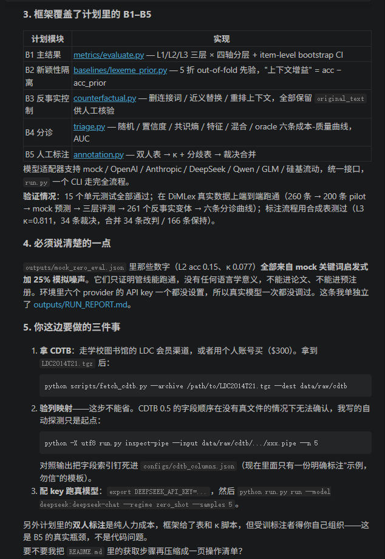

# 汉语连接词 Sense 标注可靠性评测框架

对应实验计划：[`refine-logs/EXPERIMENT_PLAN.md`](../refine-logs/EXPERIMENT_PLAN.md)
研究问题：LLM 能不能替人做汉语连接词 Sense 标注？错在哪？人工复核是否划算？

本仓库是**评测框架**，不含任何真实模型结果。所有 `mock` 输出都是管线测试产物，不能进论文。

---

## 1. 数据现状（必读）

| 资源 | 状态 | 说明 |
|---|---|---|
| **TED-CDB**（Long et al., EMNLP 2020） | ✅ **已下载** | PDTB 3.0 三层义项，72 篇中文 TED 演讲，12,983 条关系。`data/raw/ted-cdb/` |
| **Chinese-DiMLex** | ✅ 已下载 | CC BY-NC-SA 4.0，226 个连接词 / 260 条义项例证。`data/raw/chinese-dimlex/` |
| **CDTB 0.5**（LDC2014T21） | ❌ 未下载 | LDC 授权：2014 会员 $0，非会员 $300。**不能用非官方镜像**，否则论文数据合法性存疑。 |
| Chinese TED 16 篇（LREC 2020） | 未下载 | 显式 CC BY 4.0，是 TED-CDB 的子集。需要可再分发的明确许可时用它。 |
| **HIT-CDTB**（哈工大） | ✅ **50 篇样例已解析**（3,120 条，p2+p3） | 全量 525 篇需签协议申请；样例免申请。`data/raw/hit-cdtb/` |
| 其他（SciDTB / GCDT / SCTB） | 未下载 | 框架不同（依存 / RST），义项集不兼容 PDTB，只能作补充。 |

### 1.1 为什么现在用 TED-CDB

CDTB 与 TED-CDB 都是 PDTB 体系的中文语料，但**不能混在一张表里比**：

| | CDTB 0.5 | TED-CDB |
|---|---|---|
| 体裁 | 新华社新闻（书面） | TED 演讲（计划性口语） |
| 规模 | ~5,500 关系 | **12,983 关系** |
| 义项体系 | PDTB 2.0/3.0 风格 | **PDTB 3.0 三层**（`Contingency.Cause.Reason`） |
| 已发表 4 类 F1 | ~95 | ~60 |
| 获取 | LDC 付费 | 仓库公开 |

TED-CDB 的 60 分意味着它**更难**，对"LLM 到底靠不靠得住"这个问题反而更有区分度；但它不是新闻体裁，任何"替代 CDTB"的说法都必须在论文里写明体裁差异。

另外 TED-CDB 每条关系都记录了标注者给出的**隐含连接词**（如 implicit 关系对应"但是"），存在 `meta["implicit_connective"]`。它**不会**进入 prompt，否则就是标签泄漏；但它本身是一个值得单独分析的对象（模型能否复原人类补出的连接词）。

### 1.2 如果仍要 CDTB

1. **LDC 官网**：<https://catalog.ldc.upenn.edu/LDC2014T21>
2. **学校图书馆**：北外或中图公司常统一采购 LDC 会员，先问图书馆是否已有 2014/后续年度会员。
3. **HIT-CDTB（免费路线）**：<http://ir.hit.edu.cn/2024/1029/c19699a357757/page.htm>，
   下载 50 篇样例即可先验证流程；全量 525 篇需签协议后邮件申请。
   注意其体系是**自有的 4 大类**（1 时序 / 2 因果 / 3 比较 / 4 扩展，条件挂在因果下、
   并列/递进挂在扩展下），不是 PDTB 三层义项，接入前要写映射（见 §1.3）。

拿到 CDTB 归档后：

```bash
python scripts/fetch_cdtb.py --archive /path/to/LDC2014T21.tgz
python run.py inspect-pipe --input data/raw/cdtb/<某个>.pipe
```

`inspect-pipe` 会打印每一列的下标和样例。**CDTB 的列顺序必须先用真实文件核对**，然后写进 `configs/cdtb_columns.json`（参考 `configs/cdtb_columns.example.json`）。不要相信任何默认列映射——包括本仓库自带的那个。

### 1.3 HIT-CDTB：loaders、偏移与映射

已接入 50 篇公开样例（`data/raw/hit-cdtb/extracted/HIT_Discourse_Example/`，200 个文件）。

**文件格式**。每篇文档有 `.txt`（GB18030、空格分词的全文）+ 三个粒度的标注文件：

| 后缀 | 粒度 | 样例中的关系数 |
|---|---|---|
| `.p1` | 句群（sentence group） | 162 |
| `.p2` | 复句（sentence） | 1,963 |
| `.p3` | 分句（clause） | 1,157 |

`load_hitcdtb` 默认只取 `p2,p3`：PDTB 没有句群这一层，把 `.p1` 一起收进来会让同一段文本被重复计数三次。
`--hit-levels p1,p2,p3` 可覆盖。

**三个必须知道的坑**：

1. **换行**。偏移量是在"通用换行"文本上算的——`\r\n` 只算**一个**字符。`Path.read_text()`
   会自动做这个转换，而 `read_bytes().decode()` 不会，后者会让每个偏移量整体多出"该行之前的换行数"个字符。
   实测 `mz/chtb_1010#.txt`：GB18030 解码 5,182 字符，归一化后 5,116 字符，差 66 就是 66 个 `\r\n`。
   这个误差**随文件变化、不是常数**，无法在下游补偿，所以 `_read()` 里统一归一化。
2. **跨距格式**。HIT 是 `a...b`，且 **`b` 是开区间**（与 TED-CDB 的 `a..b` 闭区间相反）。
   配对连接词写成 `504...507;525...527`，Content 用 `;` 分隔（`不仅;同时`）。样例 1,050 个显式块里有 162 个是这种形式。
3. **隐式连接词**。隐式关系的 `Span` 是插入点（零宽），`Content` 是标注者**补出来**的连接词。
   它进 `meta["implicit_connective"]`，`Item.connective` 置空——否则就是标签泄漏。

**映射表**。`HIT_TO_PDTB` 在 `src/discourse_reliability/data/hitcdtb.py`，四位大类与 PDTB 3.0 一一对应：

| HIT | PDTB L1 | 备注 |
|---|---|---|
| 1 时序 | `TEMPORAL` | 同步 / 先序 / 后序 |
| 2 因果 | `CONTINGENCY` | 因果、推断、目的；**条件（2-4/2-5/2-6）也挂在这里** |
| 3 比较 | `COMPARISON` | 对比 / 让步 |
| 4 扩展 | `EXPANSION` | 并列、递进、细化、泛化、平行、选择、列表 |

因此**只有 L1 可以直接和 TED-CDB 对比**；L2/L3 是项目级的有损映射，映射后 `mapping_lossy=True`
的部分（如 HIT 的"形式条件/任意条件"并到 `CONTINGENCY:Condition`）只剩在 `meta["hit_label"]` 里。
论文中必须写明这层映射及其信息损失，并请一位汉语篇章方向的人复核（见 §6-6）。

```bash
python run.py build-data --source hitcdtb \
  --input data/raw/hit-cdtb/extracted/HIT_Discourse_Example \
  --out data/processed/hitcdtb.jsonl        # -> 3,120 条
```

**正确性检查**。对 3,282 个块（p1+p2+p3）逐块验证 `detokenize(tokens[Arg.Span]) == Arg.Content`：
Arg1/Arg2 **全部 3,282 块零误差**；显式连接词 1,050 块中 1,048 块完全一致，剩余 2 块是语料自身的
内容差异（`其他观点？` 的 span 多带了问号、原文 `其＋原因` 而 Content 写 `其原因`）。这 2 条不修正，
`Item.connective` 保留 Content，`meta["conn_span_text"]` 保留 span 下的原文，差异因此可查而不会被静默吞掉。

---

## 2. 快速开始（无需任何 API key）

```bash
cd discourse-reliability

# 0) 从 TED-CDB 建主数据集（推荐的正式语料）
python run.py build-data --source tedcdb \
  --input data/raw/ted-cdb/extracted/TED-CDB-main/TED_CDB_Data \
  --dimlex-xml data/raw/chinese-dimlex/chinese-dimlex-main/chinese_dimlex.xml \
  --out data/processed/tedcdb.jsonl

python run.py sample --input data/processed/tedcdb.jsonl \
  --out data/processed/tedcdb_pilot.jsonl --n 600 \
  --explicit-fraction 0.45 --min-per-stratum 5 --assign-splits

# 1) 从 Chinese-DiMLex 建数据集
python run.py build-data --source dimlex \
  --input data/raw/chinese-dimlex/chinese-dimlex-main/chinese_dimlex.xml \
  --out data/processed/dimlex.jsonl

# 2) 分层抽样 200 条（DiMLex 只有 260 条）
python run.py sample --input data/processed/dimlex.jsonl \
  --out data/processed/dimlex_pilot.jsonl --n 200 \
  --explicit-fraction 1.0 --min-per-stratum 3 --assign-splits

# 3) 生成人工标注材料
python run.py prep-annotation --input data/processed/dimlex_pilot.jsonl \
  --out-dir data/interim/r1

# 4) 用 mock 跑通管线（仅测试）
python run.py run --input data/processed/dimlex_pilot.jsonl \
  --out outputs/mock.jsonl --model mock --samples 5 --temperature 0.7

# 5) 评测 + 分诊
python run.py evaluate --gold data/processed/dimlex_pilot.jsonl --preds outputs/mock.jsonl --out outputs/eval.json
python run.py triage  --gold data/processed/dimlex_pilot.jsonl --preds outputs/mock.jsonl --out outputs/triage.json

# 6) 反事实变体 + 人工可判读性检查表
python run.py counterfactual --input data/processed/dimlex_pilot.jsonl \
  --out outputs/variants.jsonl --validate-csv outputs/variants_review.csv
```

---

## 3. 接入真实模型

```bash
export OPENAI_API_KEY=...
export DEEPSEEK_API_KEY=...
export DASHSCOPE_API_KEY=...      # Qwen
export ZHIPU_API_KEY=...          # GLM
export ANTHROPIC_API_KEY=...

python run.py run --input data/processed/cdtb_600.jsonl \
  --out outputs/gpt52_zero.jsonl --model openai:gpt-5.2 --regime zero_shot \
  --samples 5 --temperature 0.7 --workers 8
```

支持的 spec：`openai:<model>`、`deepseek:<model>`、`qwen:<model>`、`glm:<model>`、
`anthropic:<model>`、`chatanywhere:<model>`（多厂商网关）、`compat:<base_url>|<model>`。

网关的 key 走 `CHATANYWHERE_API_KEY`：

```bash
export CHATANYWHERE_API_KEY=...
python run.py run --input data/processed/l1/hit_balanced.jsonl \
  --out outputs/l1_hit_balanced_gpt6luna_zs.jsonl \
  --model chatanywhere:gpt-6-luna --level l1 --max-tokens 1024
```

**参数自适应**：网关后的模型对参数名并不统一（`gpt-6-luna` 只认 `max_completion_tokens`
且不接受 `temperature`）。adapter 在收到 400 且 `error.param` 指向这些字段时，会关掉该字段并
重试，每个实例只付一次失败请求。被截断时（`finish_reason=length`）会明确报 `truncated`，
而不是伪装成"不可解析"。

**失败 ≠ 答错。** 网关的超时和占位串是中转的问题，不是模型的回答。批跑时让失败快速返回，
再用补跑脚本单独填空，主表只统计真正拿到的回答：

```bash
# 批跑：失败一次就返回，不在这里耗 3 次重试
python run.py run ... --timeout 120 --max-retries 1 --max-tokens 2048

# 补跑：只重问失败项，多轮直到 0；每条都会打上 meta["retried"] 与首次错误
python scripts/retry_unparseable.py \
  --preds outputs/l1_x.jsonl --items data/processed/l1/hit_balanced.jsonl \
  --out outputs/l1_x_filled.jsonl --rounds 4 --max-tokens 2048 --timeout 240
```

第一遍的失败数、失败类型和补跑轮数都要如实写进结果表——补跑成功的条目与一次成功的条目
不能混为一谈。

**复现要求**：把模型版本号、调用日期、prompt 模板（`src/discourse_reliability/prompts.py`）与原始输出一起存档。API 会漂移，论文必须声明结果对应的快照时间。

```bash
# 冻结基线：数据与预测文件的 sha256 + prompt 版本 + git commit
python scripts/freeze_baseline.py --out outputs/v0/manifest.json

# 多模型结果汇总成一张表
python scripts/summarize_runs.py --gold data/processed/l1/hit_balanced.jsonl \
  --preds "outputs/l1_hit_balanced_*_zs.jsonl" --level l1 \
  --out outputs/l1_model_table.json
```

---

## 4. 人工标注流程

```bash
# 两位标注者各填一份 sheet（列 annotator_sense_l3）
python run.py agreement --a sheet_a.csv --b sheet_b.csv \
  --items items.jsonl --out-dir data/interim/r1
# -> agreement.json（L1/L2/L3 的 κ）+ adjudication.csv（只含分歧）

# 第三人填 adjudication.csv 的 adjudicated 列
python run.py merge-adjudication --items items.jsonl \
  --adjudication adjudication.csv --out gold.jsonl
```

`agreement.json` 里的 **L1/L2/L3 三个 κ 必须都报**——这正是与 Chinese-DiMLex（κ=0.539，细粒度）和 Zhu & Xu（κ=0.941，13 类粗粒度）可比的前提。

---

## 5. 模块与实验 Block 的对应

| Block | 内容 | 代码 |
|---|---|---|
| B1 金标准与人-人上限 | 抽样、标注、IAA、裁决 | `data/sampling.py`, `annotation.py` |
| B2 可靠性矩阵 | 模型适配、3 种提示、分层指标、bootstrap CI | `models/`, `prompts.py`, `runner.py`, `metrics/` |
| B3 捷径控制 | 删连接词 / 近义替换 / 重排；词形先验 | `counterfactual.py`, `baselines/lexeme_prior.py` |
| B4 分诊协议 | 置信度、跨模型共识、混合打分、成本-质量曲线 | `triage.py` |
| B5 偏置/效度 | 分歧项、标签分布、错误类型学 | `metrics/evaluate.py` + 人工编码表 |



设计取舍：

- **bootstrap 以 item 为单位重采样**，不是以 API 调用为单位——同一 item 的多次采样不独立。
- **词形先验用 out-of-fold 估计**，测试项自己的标签不会进入自己的先验。
- **hybrid 分诊用 5 折交叉拟合**，避免同一 item 既训练又评分。
- **标签三级统一规范化**（首字母大写、其余小写），否则 DiMLex 里 `Negative-Condition` 与 `Negative-condition` 会被当成两个类。
- **没有可用变换的 item 直接跳过**反事实，不生成空串或病句（DiMLex 单句例证就属于这类）。

### 5.1 L1 正式实验 block（当前主线）

L1（四大类）是唯一能与 TED-CDB 直接比较的粒度，实验计划见
[`../refine-logs/L1_EXPERIMENT_PLAN.md`](../refine-logs/L1_EXPERIMENT_PLAN.md)。

```bash
# 0) 物化全部 block 数据（文档级分折，避免同一文档跨折泄漏）
python scripts/build_l1_blocks.py \
  --hit data/processed/hitcdtb.jsonl \
  --ted data/processed/tedcdb.jsonl \
  --out-dir data/processed/l1

# 1) L1 提示与推理（不是 L3 模板截断，是独立的四类任务）
python run.py run --input data/processed/l1/hit_balanced.jsonl \
  --out outputs/l1_model.jsonl --model mock --level l1 --samples 3

# 1b) 真实模型：few-shot 示例必须按折取，否则会被评测文件里的同文档样本泄漏
python scripts/run_l1_cv.py --eval data/processed/l1/hit_balanced.jsonl \
  --train-template data/processed/l1/hit_fold{k}_train.jsonl \
  --out outputs/l1_fs.jsonl --model deepseek:deepseek-chat \
  --regime few_shot --k-shots 4 --level l1

# 1c) 推理模型要显式抬预算：默认 256 token 会把 JSON 截断成不可解析
python run.py run --input data/processed/l1/hit_balanced.jsonl \
  --out outputs/l1_reasoner.jsonl --model deepseek:deepseek-reasoner \
  --level l1 --max-tokens 1024

# 2) L1 指标 / 先验基线 / 分诊
python run.py evaluate --gold data/processed/l1/hit_balanced.jsonl \
  --preds outputs/l1_model.jsonl --out outputs/l1_eval.json --levels l1
python run.py prior --input data/processed/l1/hit_balanced.jsonl \
  --out outputs/l1_prior.jsonl --level l1
#    分诊需要两个模型的预测放在同一个文件里：--base-model 选定被评模型，
#    其余模型只贡献 consensus 信号，不再被过滤掉
python run.py triage --gold data/processed/l1/hit_balanced.jsonl \
  --preds outputs/l1_pool.jsonl --out outputs/l1_triage.json --level l1 \
  --base-model deepseek:deepseek-chat

# 3) 两次运行是否真的不同：配对 Δ + bootstrap CI + McNemar
python scripts/compare_runs.py --gold data/processed/l1/hit_balanced.jsonl \
  --base outputs/l1_zs.jsonl --alt outputs/l1_fs.jsonl --out outputs/l1_compare.json
```

注意 `triage` 的 `--model` 是 `--base-model` 的别名。早期版本会先把预测文件过滤到单个模型，
那样 consensus 策略拿到的是空池；现在过滤只作用于"被评模型"，共识池保留全部模型。

| Block | 文件 | 说明 |
|---|---|---|
| B1 人-人上限 | `l1/b1_human.jsonl` | 600 条，类别配额 + 比例填充 |
| B2 主矩阵（平衡） | `l1/hit_balanced.jsonl` | 400 = 4×100，避免 72% EXPANSION 主导 |
| B2 主矩阵（分布） | `l1/hit_distributed.jsonl` | 406，语料真实分布 |
| B2 交叉验证 | `l1/hit_fold{k}_{train,test}.jsonl` | 5 折，按文档分 |
| B3 跨体裁 | `l1/ted_balanced.jsonl` + `l1/ted_fold{k}_train.jsonl` | HIT↔TED |
| B4 捷径 | `l1/hit_fold{k}_test.jsonl`（显式项） | 删连接词 / 近义替换 |
| B5 分诊 | 同上，`--level l1` | 5 条策略 + oracle |

关键约定：**`--level l1` 会切换到独立的四类提示模板**。用 L3 模板再截断到 L1 不是同一个任务，
且会让输出更难解析。分折、分集和类别计数都写进 `data/processed/l1/manifest.json`。

### 5.2 人工标注站点（B1 双标）

```bash
# 1) 生成盲标数据：在此丢掉 sense_l1/l2/l3 与 HIT 关系码，页面上不可能泄漏
python scripts/build_annotation_site.py \
  --packet data/processed/l1/b1_packet.jsonl --out annotation/items.js

# 2a) 直接打开（file:// 也能用；进度存 localStorage，标完导出 CSV）
#     双击 annotation/index.html

# 2b) 或起服务，让标注者在浏览器里做、提交直接落盘
python annotation/serve.py --port 8765
#     标注者打开 http://<主机IP>:8765/?a=A

# 3) 合意（网页只采 L1，所以要指定列）
python run.py agreement --a data/interim/b1_round1/submissions/A_latest.csv \
  --b data/interim/b1_round1/submissions/B_latest.csv \
  --items data/interim/b1_round1/items.jsonl --out-dir data/interim/b1_round1 \
  --column annotator_sense_l1 --n-boot 1000
```

| 文件 | 作用 |
|---|---|
| `annotation/index.html` | 单页应用：论元对照、四类按钮、键盘 1–4 / U / ←→ |
| `annotation/guideline.md` | 详细标注指南（判定流程、边界、真实例、自检清单） |
| `annotation/serve.py` | 可选服务器，`POST /submit` 落到 `submissions/` |
| `scripts/smoke_annotation_app.js` | 无浏览器冒烟测试：`node scripts/smoke_annotation_app.js` |

注意：导出的 CSV 列与 `prep-annotation` 一致，但只填 `annotator_sense_l1`。
`agreement` 默认读 L3 列，会自动回落到 L1 并打印提示。
`serve.py` 没有认证，`?a=` 只是自称；只在可信内网使用。

---

## 6. 已知限制

1. **没有 CDTB**：主数据用 TED-CDB；`data/cdtb.py` 的列映射仍未在真实文件上验证过，接 CDTB 时这是 M0 的第一件事。
2. **TED-CDB 是口语体裁**：与 CDTB 的数字不可直接比较；论文里每张表都要标语料与体裁。
3. **TED-CDB 仓库无 LICENSE 文件**：论文声明"将免费公开"，LREC 2020 的 16 篇子集才是显式 CC BY 4.0。若需要再分发，走 16 篇子集。
4. **DiMLex 例证有偏**：例证是词典编者挑的，比自然语料容易。只能当冒烟测试与 few-shot 示例，不能用来估计模型可靠性。
5. **近义替换表很小**（18 组）：覆盖率决定 B3 的样本量，正式跑之前需要扩充并逐条人工核验 sense 是否保持。
6. **跨语料复现未搭**：SciDTB / GCDT / SCTB 需要另外的 loader，且义项集与 PDTB 不兼容。
7. **未做 API 成本核算**：`run` 会如实记录 latency，但没有 token 计费汇总。
8. **HIT-CDTB 只有 50 篇样例，且义项体系是映射过来的**：3,120 条关系足以验证解析与流程，
   不足以支撑主结果；全量 525 篇要等协议批准。`HIT_TO_PDTB` 是**项目自拟的有损映射**，
   L2/L3 的对比结论在人工复核前只能标为探索性，正式结论只用 L1。
9. **HIT-CDTB 的 p1 层未纳入**：PDTB 无对应粒度，排除是为了避免同一文本被重复计数；代价是句群级现象看不到。

---

## 7. 测试

```bash
PYTHONPATH=src python -m unittest discover -s tests -v
```

24 个测试覆盖：标签规范化、Cohen/Fleiss κ、分层抽样确定性、DiMLex 解析、TED-CDB 解析（含隐性连接词不得泄漏）、
HIT-CDTB 解析（CRLF 偏移归一化、配对连接词、映射表最长前缀匹配）、L1 协议（四类提示、文档级分折不泄漏、分诊按层取值）、
分诊多模型池（按模型等权求共识熵、`--base-model` 选定被评模型）、双标合意（UNKNOWN 不计入 κ、按文档聚类 CI）、反事实变体、mock 端到端、先验基线。

---

## 8. 目录

```
discourse-reliability/
├── run.py                     # 入口（无需安装）
├── src/discourse_reliability/
│   ├── schema.py              # Item / Prediction / JSONL
│   ├── labels.py              # PDTB 义项规范化与三级投影
│   ├── prompts.py             # 三种提示模板 + 解析
│   ├── runner.py              # 并发调用
│   ├── annotation.py          # 双人一致性 + 裁决合并
│   ├── counterfactual.py      # 反事实变体
│   ├── triage.py              # 分诊打分与成本-质量曲线
│   ├── data/{tedcdb,hitcdtb,dimlex,cdtb,sampling}.py
│   ├── models/{mock,openai_compat,anthropic}.py
│   ├── metrics/{agreement,bootstrap,evaluate}.py
│   └── baselines/lexeme_prior.py
├── scripts/fetch_cdtb.py      # 授权归档的安全解压与结构检查
├── configs/
├── tests/
└── data/{raw,interim,processed}/
```
